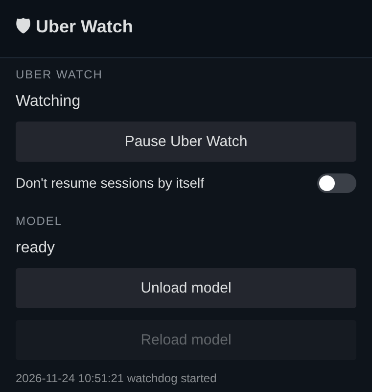
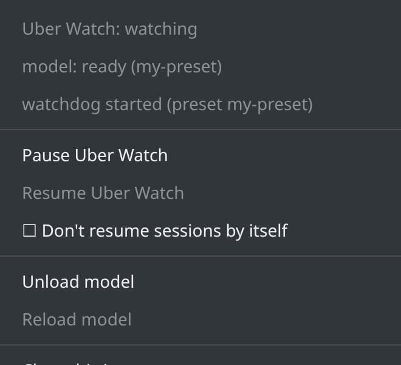

# Uber Watch

Keeps your local model server up, and gives you buttons for it: in **game mode** (Decky Loader plugin) and on the **desktop** (tray icon).

Built for the Strata local model server on Linux (Steam Deck and other handhelds included). Works with any setup where the model is started by `strata launch --preset <name>`.




*The pictures are renderings of the real menus and their labels, not screen captures.*

## What it does

- **Watches the model.** Every 20 seconds it asks the server for its model list. After about a minute of failed checks, or right after a GPU reset, it stops the old process and loads the preset again. It gives up for 10 minutes after 5 restarts in an hour.
- **Continues what was cut off.** When the model is back, when the service starts (after a reboot or logout), and when a watched service comes back after a crash, it continues every agent session whose last turn was cut off. A session you stopped yourself with Esc is left alone, and so is one that was continued in the last 10 minutes.
- **Keeps your services up** (optional). List user services in `UBER_WATCH_UNITS` and it starts any that are stopped.
- **Buttons.** Pause / Resume, Unload model (also pauses, or the watchdog would load it again), Reload model (loads the last preset and resumes if Unload paused it), and a switch "Don't resume sessions by itself".

## The buttons, in plain words

| Option | What it does |
|---|---|
| Pause Uber Watch | Stops watching. The model keeps running, but nothing restarts it if it fails. |
| Resume Uber Watch | Starts watching again: restarts the model if it fails and continues cut-off sessions. |
| Don't resume sessions by itself | On: after a restart or reboot, cut-off sessions stay stopped until you continue them. |
| Unload model | Unloads the model to free memory **and pauses Uber Watch**, so it doesn't load the model again. |
| Reload model | Loads the last model again. If Unload paused Uber Watch, it **starts watching again**. |

## Install

**Game mode panel** (needs Decky Loader; asks for sudo once):

```bash
git clone https://github.com/ubermoc/Uber-Watch && cd Uber-Watch && bash install.sh
```

Or download the zip from the latest release and unpack it into `~/homebrew/plugins/`, then restart Decky.

**Desktop part** (watchdog, service and tray icon; no sudo):

```bash
bash desktop/install.sh
mkdir -p ~/.config/systemd/user/strata-watchdog.service.d
cp desktop/settings.example.conf ~/.config/systemd/user/strata-watchdog.service.d/10-settings.conf
```

Edit `10-settings.conf` (preset, model name, address), then:

```bash
systemctl --user enable --now strata-watchdog
```

The tray icon needs `python-gobject` and `libayatana-appindicator`. It starts at your next login, or run `python3 ~/.local/share/uber-watch/uber-watch-tray.py &`.

## Files it uses

| File | Purpose |
|---|---|
| `~/.local/state/strata/watchdog.log` | what the watchdog did |
| `~/.local/state/strata/tray-state.json` | the last loaded preset (shared by the tray and the panel) |
| `~/.local/state/strata/no-resume` | exists = never continue sessions by itself |

## Build the plugin

```bash
npm install && npm run build
```

## Honest status

The panel's status and the no-resume switch were checked against a real system. Pause, Unload and Reload were written to match the tray icon and have not all been exercised from the panel. Tell me what you see.

## License

See `LICENSE`.
